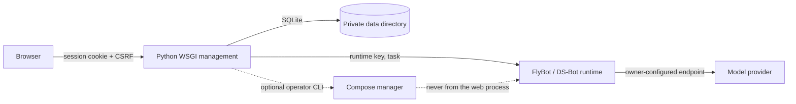

<p align="center">
  <b>OpenTeamily</b><br>
  <sub>A self-hostable workspace where people and AI agents work in the same place.</sub>
</p>

<p align="center">
  <a href="https://github.com/openTeamily/openTeamily/actions/workflows/tests.yml"></a>
  <a href="https://github.com/openTeamily/openTeamily/actions/workflows/upstream-migration.yml"></a>
  
  
  
</p>

<p align="center">
  <a href="#why-openteamily">Why</a> ·
  <a href="#what-works-today">Features</a> ·
  <a href="#architecture">Architecture</a> ·
  <a href="#quick-start">Quick start</a> ·
  <a href="#security-and-privacy">Security</a> ·
  <a href="#documentation">Documentation</a> ·
  <a href="#roadmap-and-open-gaps">Roadmap</a>
</p>

---

OpenTeamily is an independent, open-source project for running an AI-agent
workspace on infrastructure you control. It gives a team a shared agent
directory, human and agent conversations, automations, memory, a works library,
meeting notes, search, a public directory and a scoped external Agent API — with
a management plane that stays small, auditable and self-hostable.

> **Status: pre-1.0, under active development.** The slices described below have
> executable tests and honest boundaries, but this is **not** a production
> acceptance claim. Real vendor inference, real container/browser end-to-end
> runs and a full accessibility/visual review are still open. See
> [Roadmap and open gaps](#roadmap-and-open-gaps).

## Why OpenTeamily

Most agent products put the model, the data and the workspace behind a vendor
account. OpenTeamily takes the opposite route:

- **Your workspace, your data.** Accounts, workspaces, conversations, memory,
  works and agent configuration live in a local SQLite database and private data
  directory. No managed control plane is required.
- **Your runtime, your model.** OpenTeamily queues work on a runtime contract and
  lets the owner connect a FlyBot/DS-Bot instance and model endpoint. The
  management process does not run containers or contact a model vendor itself.
- **Small, inspectable slices.** The management server is Python standard
  library + SQLite + WSGI. No web framework, package manager dependency or
  hidden service is required to boot it.
- **Honest boundaries.** Every feature that is not connected says so. Counts are
  read from real records; empty states do not invent content; unverified vendor
  or visual parity is not described as done.

OpenTeamily is not affiliated with or endorsed by any commercial product or
vendor. Imported upstream trees keep their own licenses and notices.

## What works today

| Area | What is usable | What is still bounded |
|---|---|---|
| **Accounts and access** | Registration/login, sessions, CSRF and exact-Origin checks, OIDC sign-in, workspace ownership, members, roles, invites, approval/freeze, suspension | Production identity hardening, MFA, password recovery and a full deployment acceptance |
| **Home** | Signed-in `/` welcome page with the Personal Agent, real workspace totals, quick actions, recent conversations/works/meetings, onboarding and unread banners | Generated recommendations, live push, an on-home composer or vendor comparison |
| **Personal Agent** | Per-user personal space, Personal Agent, built-in roster, welcome conversation, saved look rendered as an original CSS avatar | Bitmap avatar generation and comparison with a commercial agent page |
| **Agents** | Workspace directory, categories, search/filter, archive, public unlisted homepages with quick starts, runtime binding | Modes that were not captured, embeddable conversations and a public agent marketplace |
| **Conversations** | Human↔agent conversations; social DMs/groups; unread state; pins; edit/retract; reactions; mentions; task-completion notices; media attachments; forwarding; in-conversation search | Server push, translation/ask-AI without a real provider, link previews and richer attachment context |
| **Automations** | Templates, schedules, run history, explicit/background ticks, durable results | Recorded scheduler → real container/vendor E2E and provider-backed execution |
| **Memory** | Pages, tags, links/graph, next actions and private profile sections | Generated “dream” profiles, semantic retrieval and prompt integration |
| **Works library** | Documents, websites, slides, dashboards, whiteboards, media, versions, exports, public works and read-only shares | Real-time collaboration, rich-text/animations, external data sources and same-state visual comparison |
| **Meetings** | Manual meeting notes: title, time, attendees, transcript, summary, action items and revisions | Audio/video capture, consent flow, transcription, speaker separation and automatic action extraction |
| **Search** | Authorized message search, current-conversation scope, cursor paging, file/link resources | Full-text indexing, arbitrary document extraction and cross-workspace search |
| **Discover** | Public agent catalog, public works feed, likes, collections, follows and private-scope feeds | Recommendations, ranking, comments and fabricated social totals |
| **Notifications** | Mention and task-completion notification center with read state | Server push/live delivery and preference enforcement for every notification class |
| **Agent API** | Scoped per-agent Bearer keys, rate limits, idempotent invocations, status polling and fixed errors | OAuth AI clients, streaming, broader scopes and production deployment |
| **Skills** | `/skills` library with searchable cards and in-page install toggles | Persisted installs, real skill execution, marketplace and MCP/provider scopes |
| **Settings, help and legal** | Settings persistence, appearance, language, shortcut, privacy, guide and about | Behavioral validation of every saved preference and owner-supplied legal text |
| **Runtimes and manager** | Runtime keys/connections, task transport, optional Compose manager and simulation lifecycle | Real Docker/volume/recovery acceptance and an internet-facing deployment |

The complete, per-domain gap matrix lives in
[docs/FUNCTIONAL_COMPLETION.md](docs/FUNCTIONAL_COMPLETION.md). The matrix is
deliberately conservative: a merged slice does not mean the whole domain is done.

## Architecture



- **Management plane** — authentication, workspaces, permissions, product data
  and the web UI. It never executes Docker.
- **Runtime plane** — a separately connected FlyBot/DS-Bot instance claims
  scoped tasks, talks to the owner's model endpoint and returns results. Runtime
  keys are shown once, stored as digests and revocable.
- **Optional manager** — an operator-run Compose CLI with explicit grants,
  fail-closed preflight and a separate simulation mode. It is not started by the
  development web server.
- **Data plane** — SQLite plus a private media directory. `user_version` stays
  `1`; schema changes are additive. The data directory must be owned by the
  service user and must not be a symlink.

The browser and agents never reach the orchestration host, Docker socket or
manager control channel directly. See
[docs/ARCHITECTURE.md](docs/ARCHITECTURE.md) and
[docs/SERVER_CONTRACT.md](docs/SERVER_CONTRACT.md).

## Quick start

Requirements: Python 3.11+ and, for the Node tests, Node 22+. No `pip install` is
needed for the management server.

```bash
git clone https://github.com/openTeamily/openTeamily.git
cd openTeamily

python3 -m unittest discover -s tests -v
python3 -m compileall -q openteamily tests

# Development only. The runner binds to 127.0.0.1.
python3 -m openteamily.server \
  --data-dir .state \
  --origin http://127.0.0.1:8080 \
  --insecure-local \
  --open-registration
```

Open <http://127.0.0.1:8080>. The first visit serves the signed-in home; use
`--open-registration` only while bootstrapping. Close public registration when
you no longer need it. The data directory must be private; if you create it
yourself, use `chmod 700 .state`, or let the server create it.

Tests for the browser-facing modules:

```bash
node --test tests/*.test.mjs manager/compose-planner/*.test.js scripts/ds-bot-upstream.test.mjs
```

The screenshot harness and UI review use synthetic fixture data; they are not
vendor or Teamily comparison acceptance.

## Security and privacy

- Authenticated writes require a session, a readable CSRF cookie, a matching
  `X-CSRF-Token` header and the exact configured Origin. Cross-site Fetch
  Metadata is rejected.
- HTTPS origins use `__Host-` cookies. The loopback development profile uses
  `ot_dev_*` cookies and refuses non-loopback origins.
- There is no CORS. Responses are `no-store` and do not expose stack traces,
  secrets or private paths.
- API keys, runtime tokens and skill secrets are stored wrapped or hashed and
  shown once. Lists never echo the token.
- Provider/model credentials are not discovered from the environment or the
  host; an operator or workspace owner supplies them explicitly.
- Logs omit URLs, queries, cookies and request bodies.
- The bundled WSGI runner is a development runner, not an internet-facing
  production host. A reviewed WSGI/TLS ingress, resource policy, backups and
  deployment acceptance remain required.

See [docs/MANAGEMENT_API.md](docs/MANAGEMENT_API.md),
[docs/RUNTIME_KEYS.md](docs/RUNTIME_KEYS.md) and
[docs/COMPOSE_MANAGER.md](docs/COMPOSE_MANAGER.md).

## Documentation

| Start here | What it covers |
|---|---|
| [Home](docs/HOME.md) | Signed-in workspace home and summary API |
| [Functional completion](docs/FUNCTIONAL_COMPLETION.md) | Every domain and the remaining gaps |
| [Acceptance](docs/ACCEPTANCE.md) | What evidence does and does not count |
| [Architecture](docs/ARCHITECTURE.md) | Management/runtime split and trust boundaries |
| [Management API](docs/MANAGEMENT_API.md) | Routes, auth rules, configuration and limits |
| [Runtime implementation](docs/RUNTIME_IMPLEMENTATION.md) | Lifecycle, jobs, leases and the fake backend |
| [Compose manager](docs/COMPOSE_MANAGER.md) | Operator-run container execution gates |
| [Agent gateway](docs/AGENT_GATEWAY.md) | Scoped external keys and invocations |
| [Artifacts](docs/ARTIFACTS.md) / [Studio](docs/STUDIO.md) | Works library, slides, dashboards and exports |
| [Meetings](docs/MEETINGS.md) | Manual notes, action items and revisions |
| [Messenger](docs/MESSENGER.md) | Human/agent/social conversations and group agents |
| [Memory](docs/MEMORY.md) | Pages, graph, actions and sharing |
| [Search](docs/SEARCH.md) | Authorized message and resource search |
| [Settings](docs/SETTINGS.md) | Preference keys, pages and unconnected behavior |
| [OIDC](docs/OIDC.md) | Provider sign-in and account linking |
| [Licensing](docs/LICENSING.md) | New material and imported upstream trees |

## Project layout

```text
openteamily/            management server, product modules and static UI
manager/                Compose command planner
runtime/                pinned DS-Bot tree, FlyBot social/image/web-slot adapters
services/bot-social/    imported Bot Social source snapshot
tests/                  Python WSGI tests, Node page/unit tests and fixtures
docs/                   product, API, security, acceptance and licensing notes
scripts/                CI screenshot harness, provenance checks, capture tools
```

## Roadmap and open gaps

OpenTeamily is intentionally built in reviewable slices. The next meaningful
steps are:

1. Real vendor inference and real container/browser end-to-end acceptance with
   owner-provided sandbox credentials.
2. Notification push/live delivery and behavior for every saved preference.
3. Meeting capture/consent/transcription and real audio/video call contracts.
4. Provider OAuth/connector lifecycle, MCP scopes and audited skill execution.
5. Document extraction/full-text search and richer Studio collaboration.
6. A dedicated accessibility and visual acceptance pass.

Commercial exclusions are explicit: credits, points, cash rewards, plans,
upgrades and hosted computer services are not part of this repository. OAuth,
real-time media, social features and real inference are **not** excluded; they
are unfinished work.

## Contributing

- Keep the honesty rule: a mock, a screenshot or a green unit test is not a
  vendor/container/browser acceptance.
- Prefer additive SQLite tables and keep `user_version` stable.
- Add tests for permissions, isolation, idempotency, revisions, CSRF and bounds.
- Add new Node tests to `.github/workflows/tests.yml`.
- Do not copy proprietary prompts, legal text, brand assets, fonts or screenshots.
- Use synthetic fixtures for screenshots and label them as such.

## License

New material authored in this repository is MIT-licensed; see [LICENSE](LICENSE).
Imported FlyBot customization source remains Apache-2.0 with its `NOTICE`.
Imported Bot Social source remains MIT, Copyright (c) 2026 Birfy.
`runtime/ds-bot-upstream/` is a pinned, unmodified DS-Bot copy under Apache-2.0
with its own `LICENSE` and `NOTICE`. No upstream git history is imported. See
[NOTICE](NOTICE) and [docs/LICENSING.md](docs/LICENSING.md) for the full
inventory and source offer.
