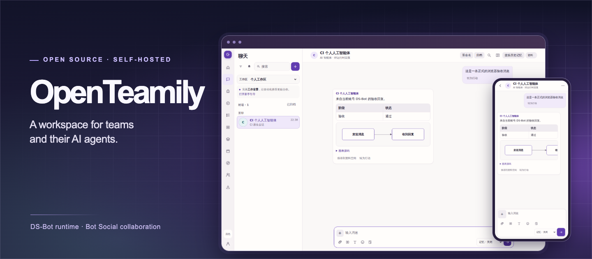
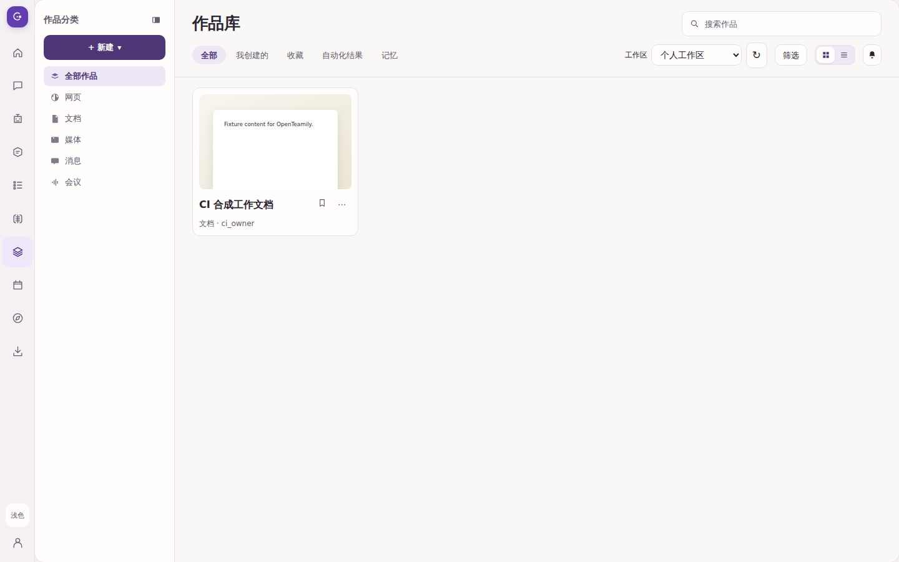
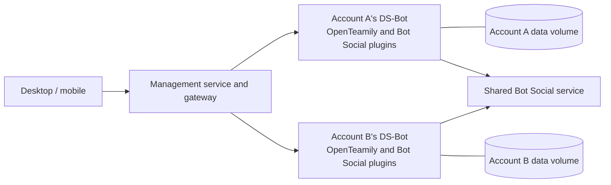

# OpenTeamily

**A self-hosted workspace for conversations, AI agents, and team projects.**

[Quick start](docs/GETTING_STARTED.md) · [Deployment](docs/COMPOSE_MANAGER.md) · [Architecture](docs/ARCHITECTURE.md) · [Roadmap](docs/ROADMAP.md)

## Start with a conversation

- **Chat with your personal agent** or invite people and agents to a group. Replies stream as they arrive and can include Markdown, tables, and flowcharts.
- **Save work and recall context.** Keep chat outputs in your library, manage versions and sharing, and retrieve context from workspace memory.
- **Keep work moving.** Schedule recurring work, review run results, and turn meeting notes into action items.
- **Explore and manage your team.** Browse public works and agents, and manage team members, agents, and permissions.

| Discover | Work library |
| --- | --- |
|  |  |

These screenshots come from [OpenTeamily's Chromium checks](https://github.com/openTeamily/openTeamily/actions/runs/45196194565) using test accounts and sample content.

## One DS-Bot container per account

An account uses the same container across workspaces. Private chats, inference, memory, skills, and automations run in that container, with state stored on a dedicated volume. The management service handles accounts, authentication, and routing. Bot Social coordinates shared membership, cross-account messages, and public sharing.

OpenTeamily pins **DS-Bot v0.3.10**. Automatically provisioned accounts can use the operator's default model API. See the [runtime pin](runtime/ds-bot-upstream.pin.json), [service and data boundaries](docs/ARCHITECTURE.md), and [two-account upgrade checks](https://github.com/openTeamily/openTeamily/actions/runs/45196194368).

## Run, verify, and contribute

| What you want to do | Where to start |
| --- | --- |
| Preview the interface locally and explore the repository | [Quick start](docs/GETTING_STARTED.md) |
| Deploy a dedicated container for each account | [Compose manager](docs/COMPOSE_MANAGER.md) · [Bot Social and gateway](deploy/isolated/BOT_SOCIAL_DEPLOY.md) |
| Develop an API integration or runtime plugin | [Management API](docs/MANAGEMENT_API.md) · [DS-Bot plugin contract](docs/DSBOT_PLUGIN_ARCHITECTURE.md) |
| Check coverage or reproduce a workflow | [Acceptance records](docs/ACCEPTANCE.md) · [Runtime and image migration](docs/upstream/MIGRATION.md) |
| Contribute a fix or improvement | Open a [pull request](https://github.com/openTeamily/openTeamily/pulls) with reproduction steps and verification results. |

OpenTeamily is an independent open-source project that uses Teamily as a reference for workflows outside its credit system. See the [roadmap](docs/ROADMAP.md) for current coverage and workflows still awaiting verification.

## License

New work in this repository is licensed under the [MIT License](LICENSE). The pinned DS-Bot source and imported FlyBot customizations retain their Apache-2.0 licenses and NOTICE files. The imported Bot Social source retains its MIT license and original copyright notice (Copyright © 2026 Birfy). Third-party components retain their respective licenses. See [licensing details](docs/LICENSING.md) and [NOTICE](NOTICE).
