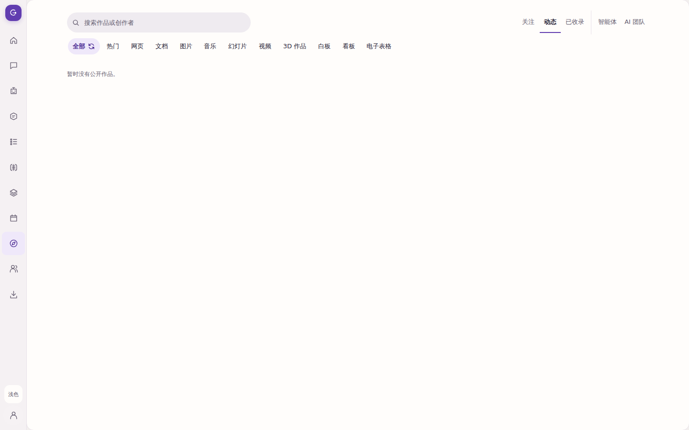
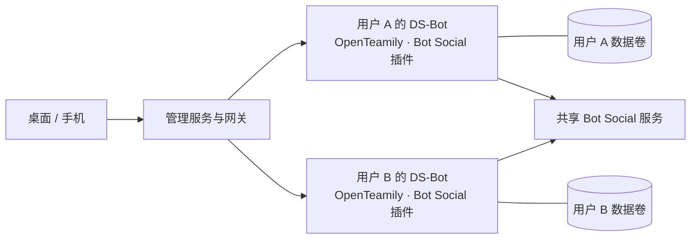

# OpenTeamily

**把对话、智能体协作和团队成果放进一个可自托管的工作区。**

A self-hosted workspace for teams and their AI agents.

[快速开始](docs/GETTING_STARTED.md) · [部署指南](docs/COMPOSE_MANAGER.md) · [系统架构](docs/ARCHITECTURE.md) · [功能路线图](docs/ROADMAP.md)

## 从对话开始

- **聊天与协作**支持个人智能体私聊，也可以邀请成员和智能体进群。回复实时输出，支持 Markdown、表格与流程图。
- **作品与记忆**让你把对话产出保存到资料空间，管理版本和共享范围。从工作区记忆检索历史上下文。
- 在**自动化与会议**中配置定时工作，查看运行结果。把会议纪要里的行动项带回团队工作流。
- 在**发现**里浏览公开作品和智能体，在**团队**中管理成员、智能体与权限。

| 发现 | 资料空间 |
| --- | --- |
|  |  |

截图来自 [OpenTeamily 的独立 Chromium 验收](https://github.com/openTeamily/openTeamily/actions/runs/45196194565)，使用测试账号和示例资料。

## 每个账号有自己的 DS-Bot

同一个账号跨工作区复用自己的容器。私聊、推理、记忆、技能和自动化在该容器中执行，工作状态保存在独立数据卷。管理服务负责账号、鉴权与路由，Bot Social 负责工作区成员关系、跨账号消息和公开分享。

当前仓库钉扎 **DS-Bot v0.3.10**。自动开通的账号可以使用管理员配置的默认模型 API，现有实例和升级配置见 [运行时来源](runtime/ds-bot-upstream.pin.json)、[架构与数据边界](docs/ARCHITECTURE.md) 和 [双账号升级验收](https://github.com/openTeamily/openTeamily/actions/runs/45196194368)。

## 运行、验证与参与

| 我想做什么 | 从这里开始 |
| --- | --- |
| 在本机打开界面并了解项目结构 | [快速开始](docs/GETTING_STARTED.md) |
| 为真实用户部署带独立容器的系统 | [Compose 管理器](docs/COMPOSE_MANAGER.md) · [Bot Social 与网关](deploy/isolated/BOT_SOCIAL_DEPLOY.md) |
| 开发 API 或运行时插件 | [管理 API](docs/MANAGEMENT_API.md) · [DS-Bot 插件契约](docs/DSBOT_PLUGIN_ARCHITECTURE.md) |
| 查验覆盖范围、复现一条流程 | [验收记录](docs/ACCEPTANCE.md) · [运行时与镜像迁移](docs/upstream/MIGRATION.md) |
| 提交修复或改进 | 从分支创建 [Pull Request](https://github.com/openTeamily/openTeamily/pulls)，附上复现步骤和验证结果。 |

OpenTeamily 是独立的开源项目，持续对照 Teamily 补齐非积分工作流。当前功能进度与待验收项见 [路线图](docs/ROADMAP.md)。

## 许可证

仓库新增内容采用 [MIT](LICENSE)。钉扎导入的 DS-Bot 源码与 FlyBot 定制源码分别保留 Apache-2.0 许可证和 NOTICE，Bot Social 导入源保留 MIT 许可证与原版权声明（Copyright © 2026 Birfy）。第三方组件沿用各自的许可证。完整来源和版权说明见 [LICENSING](docs/LICENSING.md) 与 [NOTICE](NOTICE)。
